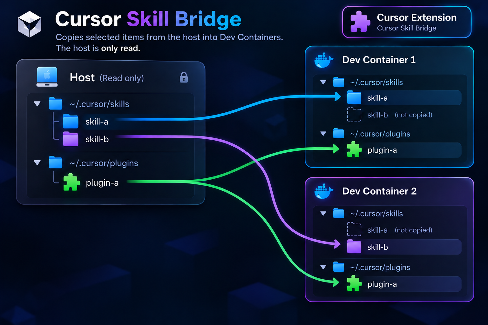

# Cursor Skill Bridge

Copies selected Cursor skills and plugins from the host into the Dev Container user's home directory. The host is read-only. The extension does not modify `devcontainer.json`.

## The problem

Skills and local plugins live on the host, in `~/.cursor/skills` and `~/.cursor/plugins/local`. A Dev Container has its own home directory, and the host home is not mounted there, so the agent inside the container cannot read them.

## How it works



## Install

Install the VSIX on the host. The extension runs in the local extension host (`"extensionKind": ["ui"]`). If Cursor asks where to install, choose the local installation.

```bash
npm install
npm test
npm run package
```

`npm run package` writes `cursor-skill-bridge-1.0.0.vsix`.

## Usage

The extension discovers `~/.cursor/skills/<name>` and `~/.cursor/plugins/local/<name>` when that folder contains `.cursor-plugin/plugin.json` or `plugin.json`.

In Explorer → **Cursor Skills/Plugins**, the checkbox syncs an item for this workspace. Right-click → `Sync Cursor Item in User Settings` syncs it for every workspace. `~` in a destination is the container user's HOME.

Sync runs when a Dev Container opens, unless `cursorSkillBridge.autoSync` is off, and from `Cursor Skill Bridge: Sync Cursor Skills/Plugins`. After a new plugin is copied, reload the window: Cursor reads `~/.cursor/plugins/local` at startup. Failures are in Output → `Cursor Skill Bridge`.

Command Palette (`Ctrl+Shift+P`, `Cmd+Shift+P` on macOS):

- `Cursor Skill Bridge: Choose Local Cursor Skills/Plugins` — choose discovered items for this workspace or for every workspace
- `Cursor Skill Bridge: Sync Cursor Skills/Plugins` — copy the enabled folders now
- `Cursor Skill Bridge: Refresh Cursor Skills/Plugins` — reload the Explorer list
- `Cursor Skill Bridge: Add Cursor Sync Folder` — add any host folder
- `Cursor Skill Bridge: Sync Cursor Item in User Settings` — sync the selected Explorer item in every workspace
- `Cursor Skill Bridge: Remove Cursor Sync Folder` — remove a folder you added

## Settings

One key, `cursorSkillBridge.folders`. User Settings apply to every workspace. A workspace entry for the same path overrides the user entry. `enabled: false` keeps the path and skips sync. A string is an enabled path. `path` may be absolute or `~/...` for the host home. A relative path uses a locally opened workspace folder; inside a Dev Container it is resolved from the host home.

If `target` is omitted, the container destination is chosen from the source path:

- `~/.cursor/skills/<name>` → `~/.cursor/skills/<name>`
- `~/.cursor/plugins/local/<name>` → `~/.cursor/plugins/local/<name>`

*Any other folder is copied only to the `target` you set. If `target` is missing, or the source folder does not exist, that item is skipped and a warning is written to Output → `Cursor Skill Bridge`.*

*Discovery lists only the immediate subfolders of the first two directories. A plugin folder must contain `.cursor-plugin/plugin.json` or `plugin.json`. `~/.cursor/plugins/cache` is not scanned. A settings path is classified by those prefixes even when it was not discovered. `~` in `target` is the container user's home.*

User settings:

```json
{
  "cursorSkillBridge.folders": [
    "~/.cursor/skills/sequential-best-of-n"
  ]
}
```

`.vscode/settings.json`, the same list as [`examples/settings.json`](examples/settings.json):

```json
{
  "cursorSkillBridge.autoSync": true,
  "cursorSkillBridge.watch": true,
  "cursorSkillBridge.folders": [
    {
      "path": "~/.cursor/skills/time",
      "enabled": true
    },
    {
      "path": "~/.cursor/plugins/local/example-plugin",
      "enabled": true
    },
    {
      "path": "~/projects/my-tools",
      "target": "~/.cursor/plugins/local/my-tools",
      "enabled": true
    }
  ]
}
```

## Copy behavior

A file is written again only when its bytes differ. Files already in the container outside the copy are left in place. `.git` is skipped, and so is a symlink that points outside the source folder. Executable files receive `chmod a+x`.

Host changes are watched while the selection has at most 5000 files. Above that, sync runs on connect and from the command. Details: [docs/limitations.md](docs/limitations.md).

## License

[MIT](LICENSE)
